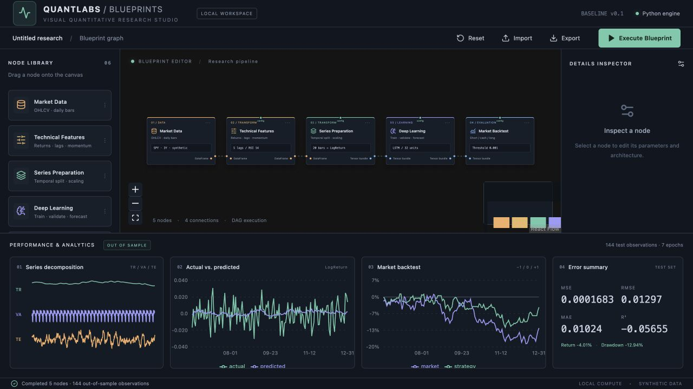
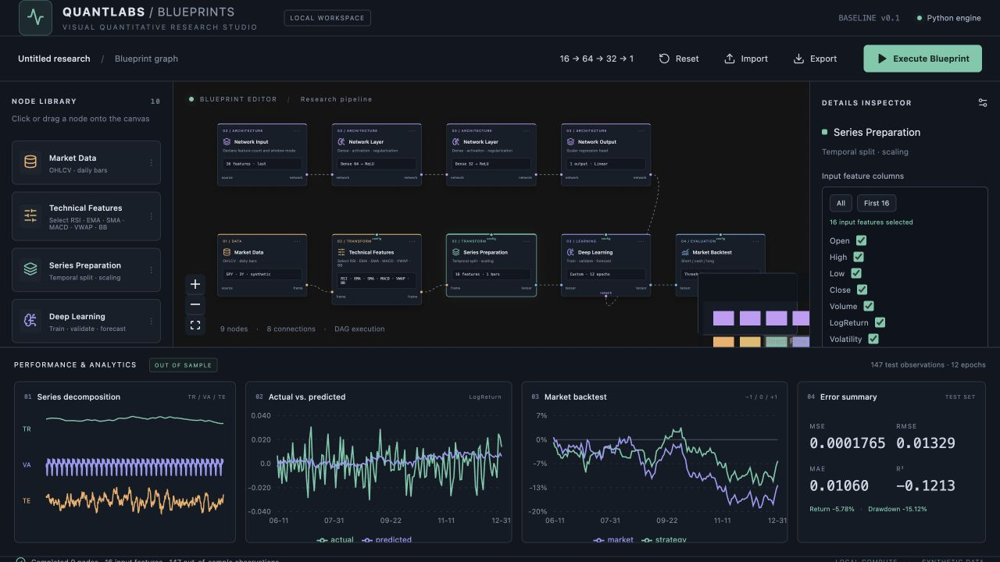

# Quantlabs-Blueprints

Estudio de escritorio para investigación cuantitativa mediante un grafo visual de nodos: datos → indicadores → preparación temporal → aprendizaje profundo → backtest. Base funcional para macOS y Windows, con Electron, React y un motor Python local.

El código se encuentra en [`quant-blueprint-studio/`](quant-blueprint-studio/). Incluye un pipeline sintético reproducible para ejecutar sin descargar cotizaciones. Para datos reales, seleccionar `yfinance` en **Market Data**.



## Tecnologías y versiones

| Tecnología | Rango declarado | Función |
| --- | --- | --- |
| Node.js | 22+ | Herramientas de desarrollo |
| Electron | 42.x | Aplicación de escritorio e IPC aislado |
| React / React DOM | 19.x | Interfaz |
| TypeScript | 5.x, desde 5.7 | Tipado estricto, sin `any` |
| React Flow (`@xyflow/react`) | 12.x, desde 12.9 | Lienzo, conexiones y nodos personalizados |
| Vite | 6.x, desde 6.4.1 | Servidor de desarrollo y compilación |
| Recharts | 3.x | Paneles analíticos |
| Lucide React | 0.468.x | Iconos |
| Python | 3.10–3.13 recomendado | Compatibilidad de paquetes binarios PyTorch |
| PyTorch | ≥2.5, <3 | Modelos y entrenamiento CPU |
| pandas / NumPy | ≥2.2, <3 / ≥1.26, <3 | Datos y arrays |
| scikit-learn | ≥1.5, <2 | Escaladores y métricas |
| FastAPI / Uvicorn | ≥0.115, <1 / ≥0.34, <1 | API y WebSocket locales |
| yfinance | ≥0.2.54, <1 | OHLCV diario ajustado |
| statsmodels / arch | ≥0.14, <1 / ≥7.2, <9 | Descomposición; arch disponible para extensiones |

`package-lock.json` fija las versiones resueltas de JavaScript. `requirements.txt` establece los rangos Python; consultar las versiones verificadas en [`VERIFICATION.md`](VERIFICATION.md).

## Instalación y arranque

Instalar Node.js 22+ y Python 3.10–3.13 con soporte `venv`. La primera instalación requiere internet y espacio para PyTorch y Electron.

```bash
git clone https://github.com/rmrodriguezgit/Quantlabs-Blueprints.git
cd Quantlabs-Blueprints/quant-blueprint-studio
```

### macOS

```bash
chmod +x start_mac.sh
./start_mac.sh
```

### Windows

Abrir `start_windows.bat` desde el Explorador o una terminal. El lanzador intenta `py -3.13` y luego `python`; este último debe apuntar a una versión compatible si no está instalado Python 3.13.

Ambos lanzadores verifican las herramientas, crean `.venv`, instalan los requisitos Python y los paquetes npm si faltan, arrancan el backend y esperan su disponibilidad. Al cerrar la sesión de Electron se detiene el proceso Python creado por el lanzador. Puertos locales: **8000** (motor), **5173** (Vite).

### Arranque manual / navegador

```bash
cd quant-blueprint-studio
python3.12 -m venv .venv
source .venv/bin/activate # Windows: .venv\Scripts\activate.bat
python -m pip install -r requirements.txt
npm ci
python backend/server.py
# Otra terminal, en el mismo directorio:
npm run electron:dev
# Alternativa web: npm run dev y abrir http://127.0.0.1:5173
```

## Uso

1. Ejecutar **Execute Blueprint** sobre el pipeline inicial. Los datos sintéticos están etiquetados en pantalla.
2. Seleccionar un nodo para editar sus parámetros. Arrastrar nuevos nodos desde la biblioteca.
3. Conectar pines compatibles: naranja = DataFrame; azul = bundle con arrays de secuencias; verde = configuración. Cada entrada acepta una conexión; la interfaz y el motor rechazan ciclos.
4. Consultar los cuatro paneles: TR/VA/TE separados, real vs. pronóstico, equity de estrategia/mercado y MSE/RMSE/MAE/R².
5. **Export** guarda el grafo JSON; **Import** lo recupera. El editor también conserva el último grafo en almacenamiento local. **Reset** restaura el ejemplo inicial.

## Diseñar una red 16 → 64 → 32 → 1



Usar el botón **16 → 64 → 32 → 1** de la barra superior para cargar un ejemplo completo. También se puede importar [`examples/dense-16-64-32-1.json`](quant-blueprint-studio/examples/dense-16-64-32-1.json).

1. En **Technical Features**, activar/desactivar RSI, EMA, SMA, MACD, VWAP y BB y ajustar sus periodos. VWAP usa precio típico ponderado por volumen en una ventana móvil de barras diarias; no es VWAP intradía reiniciado por sesión. BB usa desviación poblacional (`ddof=0`).
2. En **Series Preparation**, marcar las columnas de entrada. El inspector muestra el número seleccionado. El objetivo de predicción se elige aparte.
3. Añadir **Network Input**, declarar 16 características y seleccionar `last`: la red recibe los 16 valores de la última barra disponible. `flatten` usa `lookback × características` valores. El ejemplo usa lookback 1.
4. Conectar pines morados: **Network Input → Network Layer (Dense, 64, ReLU) → Network Layer (Dense, 32, ReLU) → Network Output (1)**.
5. Conectar **Network Output** al pin morado `network` del entrenador **Deep Learning** y **Series Preparation** al pin azul. La arquitectura conectada tiene prioridad sobre el selector del entrenador.
6. Ejecutar. Se validan las dimensiones antes de entrenar; el ejemplo crea matrices 16×64, 64×32 y 32×1. Los números 64 y 32 son neuronas de dos capas ocultas.

**Network Layer** permite añadir Dense, ReLU, Tanh, GELU, Sigmoid, LeakyReLU, Dropout o BatchNorm. Las capas Dense permiten elegir su activación, incluida Identity. El cabezal de salida es lineal y escalar para el objetivo de pronóstico actual. Los presets LSTM/GRU/CNN/AE/DQN siguen disponibles en el entrenador cuando no hay una arquitectura conectada.

Se pueden ramificar salidas hacia varios consumidores, duplicar nodos desde el inspector y añadirlos con clic o arrastrando. **Merge Features** combina dos ramas por fecha mediante entradas A y B; elimina columnas idénticas y rechaza nombres con valores contradictorios. Una arquitectura puede alimentar varios entrenadores: comparten el diseño y entrenan pesos independientes. El límite de seguridad sigue siendo 50 nodos y 150 conexiones; no se admiten ciclos.

## Guardar y recuperar

**Export** descarga un `.json` con los nodos, posiciones, conexiones y parámetros. **Import** abre ese archivo. El editor también restaura automáticamente su último diseño desde el almacenamiento local de esa instalación. El JSON no incluye cotizaciones, resultados ni pesos entrenados; tras importarlo se ejecuta otra vez el pipeline. Para conservar variantes, exportarlas con nombres diferentes. El botón de ejemplo sustituye el grafo actual: exportarlo antes si se quiere conservar.

## Motor y decisiones de evaluación

- Kahn ordena el DAG independientemente del orden visual de los nodos. Los nodos se ejecutan secuencialmente y el servidor permite una ejecución a la vez.
- Indicadores seleccionables: RSI, EMA, SMA, MACD (línea/señal/histograma), VWAP móvil y bandas de Bollinger (media/superior/inferior), con periodos configurables. Retornos logarítmicos y volatilidad móvil20 permanecen disponibles; lags 0…60 (0 los desactiva). Barras diarias, historia 1–10 años.
- En cada ventana, los datos hasta `t-1` pronostican el objetivo en `t`. División cronológica 65% entrenamiento / 15% validación / 20% prueba por defecto. Las ventanas de prueba pueden usar observaciones previas ya disponibles: evaluación móvil de un paso, sin reentrenamiento.
- El escalador de características y la normalización del objetivo se ajustan únicamente con entrenamiento. Early stopping utiliza validación y restaura los mejores pesos; prueba se reserva para métricas finales.
- TR = tendencia, VA = componente estacional, TE = residuo. Son componentes de serie, **no** abreviaturas de train/validation/test. La descomposición usa la serie completa como diagnóstico visual; nunca alimenta el modelo ni la estrategia.
- Modelos: Dense, Conv1D, LSTM, GRU, BiLSTM, BiGRU, CNN-LSTM, Autoencoder y DAE con ruido. Parámetros: capas, unidades, kernel, dropout, BatchNorm, L1/L2, Adam/SGD, epochs, batch size y paciencia. El tamaño de entrada se infiere y la salida de regresión es escalar.
- Autoencoder/DAE entrenan reconstrucción y un cabezal supervisado de pronóstico sobre el espacio latente. DQN usa replay offline de transiciones de mercado, recompensas por acción, red objetivo y un cabezal auxiliar de regresión; sus señales proceden del cabezal Q. Es una base experimental, sin costes/posición en el estado del agente ni búsqueda de hiperparámetros.
- Backtest: Short −1, Cash 0, Long +1; aplica el pronóstico al retorno futuro correspondiente, capitalización con retornos simples, costes por turnover y liquidación final. Solo acepta objetivo `LogReturn`; para `Close` o `Volatility`, retirar el nodo Backtest.
- Pines azules transportan bundles Python tipados con secuencias NumPy que el modelo convierte en tensores PyTorch; los objetos grandes/modelos permanecen en el motor. Se serializan únicamente resultados y diagnósticos.
- Un nodo Config sobreescribe los parámetros coincidentes del nodo conectado. Para comparar múltiples modelos, ejecutar grafos separados: los paneles muestran el último modelo/backtest en orden topológico.

## API

- `GET /api/health`: estado y PID.
- `POST /api/execute`: JSON con `nodes` y `edges`; devuelve resultados para los paneles. HTTP 422 para grafos/parámetros inválidos; 409 si el motor está ocupado.
- `WS /ws/execute`: enviar el mismo JSON; recibir eventos por nodo `{node,status}` y un evento final `{event:"result",result}` o `{event:"error",detail}`.

Electron usa un preload con `contextBridge`, aislamiento de contexto, sandbox y Node desactivado en el renderer. Su puente IPC envía el grafo al endpoint fijo. El modo navegador usa POST directo. El backend escucha exclusivamente en loopback y admite CORS de los dos orígenes de desarrollo.

Los autoencoders también devuelven `autoencoder.latent` y `autoencoder.reconstructed` en la respuesta de la API, en el espacio escalado de características.

## Validación y compilación

```bash
cd quant-blueprint-studio
npm run typecheck
npm run build
.venv/bin/python -m unittest discover -s backend/tests -v
# Windows: .venv\Scripts\python.exe -m unittest discover -s backend/tests -v
```

La suite cubre orden topológico, ciclos, pines incompatibles, escalado sin filtración del test, las diez arquitecturas, alineación y costes del backtest, HTTP y WebSocket. Las cotizaciones reales dependen del servicio externo y no se utilizan en las pruebas deterministas.

Después de compilar, arrancar el motor por separado y usar `npm run electron:start` para cargar el renderer compilado. Esta base no genera instaladores `.dmg`/`.exe` ni incorpora Python en un binario distribuible.

## Estructura

```text
quant-blueprint-studio/
├── package.json, package-lock.json, tsconfig*.json, vite.config.ts
├── start_mac.sh, start_windows.bat, requirements.txt
├── scripts/                 # Espera del motor y lifecycle Windows
├── src/main/                # Electron main + preload IPC
├── src/renderer/
│   ├── App.tsx, main.tsx, styles.css
│   ├── components/          # Canvas, inspector, paneles de rendimiento
│   └── types/blueprint.ts   # Tipos, catálogo y grafo inicial
└── backend/
    ├── server.py
    ├── engine/dag_runner.py
    ├── engine/nodes/        # Datos, preparación, modelos, backtest
    └── tests/test_engine.py
```
