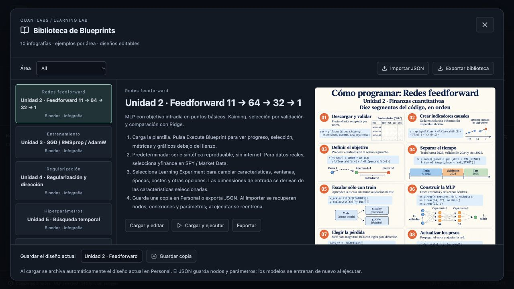
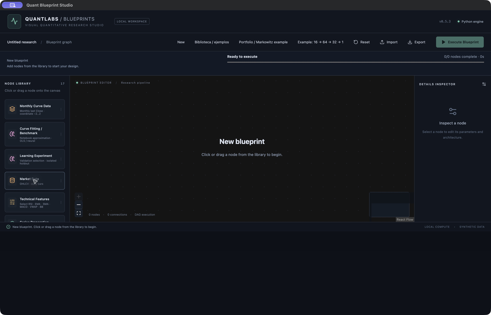
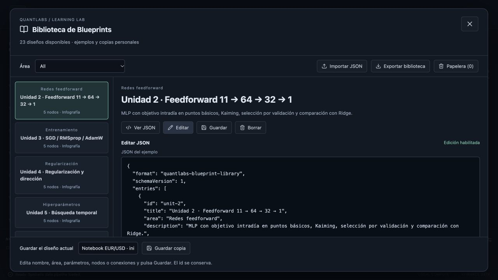

# Biblioteca de Blueprints — v0.7.0

La aplicación incluye **27 diseños ejecutables**: seis recetas nuevas de investigación y dos recetas modulares, además de tres variantes del [notebook EUR/USD](NOTEBOOK_EURUSD.md) y los quince diseños base descritos abajo: diez basados en las diez imágenes encontradas (unidades 2–10 y ampliación cDCGAN) y cinco ejemplos adicionales. Se incorpora además la infografía Keras 1→256→1 adjuntada por el usuario, con su propio ejemplo; son 11 imágenes.

## Nuevo diseño

Pulsa **New** en la barra o **File → New** en Electron; atajo **⌘N** en macOS / **Ctrl+N** en Windows. El diseño actual con nodos se archiva automáticamente en Personal si no estaba guardado. New abre un lienzo vacío, distinto de Reset, que carga el pipeline predeterminado. El borrador vacío se autoguarda y puede importarse/exportarse; Execute está desactivado hasta añadir nodos. Durante una ejecución se conserva el diseño activo y se espera a que termine.

## Usarla y recuperar diseños

1. Abre **Biblioteca / ejemplos** en la barra superior.
2. Filtra por área y selecciona una ficha. Lee sus instrucciones y amplía la infografía pulsándola.
3. **Cargar y editar** lleva el diseño al lienzo. **Cargar y ejecutar** también inicia el motor y su monitor de progreso.
4. Selecciona nodos para ajustar datos, indicadores, características, ventanas, arquitectura, épocas y costes. El número de entradas se deriva de las características seleccionadas y aparece encima del lienzo.
5. Abre otra vez la biblioteca, escribe un nombre y pulsa **Guardar copia**. Se conserva en **Personal**, en este equipo y perfil de la aplicación. Al cargar una plantilla también se archiva el diseño anterior si aún no estaba guardado.
6. Para otra computadora o una copia externa, usa **Exportar** en la ficha o en la barra principal. **Exportar biblioteca** guarda todas las fichas incluidas y personales en un archivo.
7. **Importar JSON** en la biblioteca añade copias a Personal. El Import principal abre directamente una ficha; si recibe varias, las incorpora a la biblioteca.

El JSON lleva `format: quantlabs-blueprint-library` y `schemaVersion: 1`. Se admiten también los grafos JSON antiguos con `nodes`/`edges`. Se validan tipos de nodos, conexiones, pines, dimensiones configuradas, valores finitos y ausencia de ciclos. Hay un máximo de 100 fichas personales; exporta y elimina copias para liberar espacio. El límite por archivo es 10 MB.

El autoguardado del lienzo continúa funcionando. Los datos de Personal y el lienzo se guardan en localStorage; navegador, Electron de desarrollo y Electron compilado pueden tener almacenamientos distintos. Usa JSON para transferir entre ellos. Se guardan **diseños y parámetros**, no cotizaciones, pesos entrenados ni resultados. Cada ejecución descarga/genera los datos y vuelve a entrenar. Las imágenes originales vienen con la aplicación y se referencian por nombre; un JSON aislado requiere la misma versión de la aplicación para mostrarlas.

## Ver, editar, guardar y borrar un ejemplo

Cada ficha ofrece **Ver JSON**, **Editar**, **Guardar** y **Borrar**, tanto en ejemplos incluidos como en Personal.

1. **Ver JSON** muestra el documento completo en modo de lectura.
2. **Editar** habilita el editor y Guardar. Puedes cambiar título, área, instrucciones, nodos, parámetros y conexiones; el identificador de la ficha se conserva.
3. **Guardar** o **Guardar cambios** valida el JSON y el grafo antes de actualizar esa ficha. Los parámetros específicos del entrenamiento se comprueban al ejecutar. Un JSON inválido no reemplaza el guardado. **Cancelar** descarta el borrador; los cambios pendientes protegen el cierre y New.
4. **Usar lienzo actual** copia el grafo del lienzo al borrador del editor. Después pulsa Guardar. **Guardar copia**, en el pie, crea una ficha personal independiente.
5. **Borrar** mueve la ficha a **Papelera**. Abre Papelera y pulsa **Restaurar** para recuperar su nombre, parámetros y conexiones. No hay borrado definitivo desde esta pantalla.

Los cambios a ejemplos incluidos se guardan como modificaciones locales: los archivos originales distribuidos con la aplicación se conservan. Las fichas modificadas llevan una marca. Guardar exactamente el JSON original elimina la modificación local. Exportar biblioteca incluye las versiones activas modificadas y excluye las fichas de Papelera. Exporta JSON para trasladar cambios entre equipos o perfiles; el guardado local no sincroniza con GitHub.

## Plantillas e implementación

| Ficha | Ejecución |
| --- | --- |
| Unidad 2 | MLP 11→64 ReLU→32 ReLU→1; inicialización Kaiming, MSE, escalado X/y sólo TR, checkpoint VA, comparación TE con Ridge |
| Unidad 3 | SGD, RMSprop y AdamW con mismos pesos iniciales, arquitectura, datos y presupuesto máximo; ganador según MSE VA en bps² |
| Unidad 4 | Clasificación de dirección: baseline, Dropout .3, L1 1e−5 sólo pesos, L2 1e−3, BatchNorm y early stopping; selección por BCE de datos sin penalización; sigmoid y umbral .5 |
| Unidad 5 | Búsqueda aleatoria: anchos 32/64/128, profundidad 1/2/3, LR log-uniforme y L2; dos folds expansivos dentro de TR, escalas nuevas por fold; selección por RMSE original; VA exterior fija checkpoint final |
| Unidad 6 | Dos Conv1D 11→32→64 kernel3, ReLU, adaptive average pool y salida 1; compara MLP con idénticas ventanas de 20 sesiones |
| Unidad 7 | LSTM, GRU, BiLSTM, BiGRU; 32 unidades por dirección, unión de estados finales; ventanas históricas de 20 sesiones; selección VA y referencia Ridge |
| Unidad 8 | PCA y AE/DAE 11→32→3→32→11; reconstrucción independiente del objetivo; ruido gaussiano .1 en DAE; elige AE/DAE por reconstrucción VA; Ridge posterior y reconstrucción TE separados |
| Unidad 9 | CVAE con reparametrización y pérdida MSE + .01 KL; cGAN con entrenamiento alternado; ventanas de 16 retornos y condición causal de volatilidad |
| Unidad 9 ampliación | cDCGAN con ConvTranspose1D/Conv1D, condiciones de volatilidad/momentum/volumen, embeddings de activo y régimen; tres activos conectados, fechas comunes, mismo ruido entre regímenes |
| Unidad 10 | Double DQN: estado de 11 indicadores + posición, 64→32→3 valores Q; replay TR, máscara terminal, online elige/target evalúa, Huber, gamma .95 y sincronización cada 100 actualizaciones; compara Q-learning/largo/efectivo |
| Retornos | LogReturn y CumulativeLogReturn en un gráfico con series identificadas |
| Indicadores | Close, EMA, SMA, VWAP y bandas de Bollinger; el nodo permite activar MACD, RSI y otros indicadores |
| Estadística | Preparación cronológica, escalador y descomposición diagnóstica TR/VA/TE |
| Arquitectura y backtest | Network Input→Dense64→Dense32→Network Output conectado a entrenador; capas editables y backtest Short/Cash/Long |
| Portafolios y riesgo | SPY,SAN,JPM,HWM,WM,PLTR; pesos iguales, máximo Sharpe y mínima varianza; indicadores completos de cartera y activos |

Los diez experimentos nuevos se encapsulan en **Learning Experiment**, con un pin DataFrame de entrada y un bundle de informe en el pin azul. El área de arquitectura mantiene las capas individuales conectables. En Learning Experiment, `widths` modifica las anchuras de la MLP; el número de entradas procede de `feature_columns`. CNN/recurrentes/generativos/RL usan las arquitecturas específicas descritas arriba.

Para cDCGAN, el pin principal es el primer activo; `asset_b` y `asset_c` admiten dos ramas opcionales de otros activos. La plantilla conecta SPY, SAN y JPM con semillas sintéticas distintas. Se pueden cambiar los tres símbolos y sus fuentes independientemente. Las ventanas se alinean por fecha antes de dividirse: ningún entrenamiento de un activo consulta fechas de validación/test de otro. Los regímenes se definen por momentum estandarizado menor que −.5, entre −.5 y .5 o mayor que .5. Son categorías didácticas, no regímenes económicos inferidos externamente.

## Objetivos, costes y lectura de resultados

Los quince ejemplos base usan datos **sintéticos** por defecto para funcionar sin internet. Las tres fichas nuevas del notebook EUR/USD usan yfinance por defecto, como su documento de referencia. Cambia Market Data a `yfinance` para datos ajustados reales. Seleccionar SPY sin cambiar la fuente no transforma datos sintéticos en cotizaciones de SPY.

En las unidades supervisadas, una ventana termina al cierre de t y predice `10000 × log(Close[t+1] / Open[t+1])`: retorno intradía siguiente en puntos básicos. Las operaciones supervisadas entran en la apertura, salen al cierre y quedan en efectivo durante el gap. Cobran dos cambios de posición por sesión (entrada y salida), a 5 bps cada uno por defecto. El gráfico de referencia usa también sólo intradía, sin costes, para comparar el mismo intervalo. ROI, Sharpe y drawdown del experimento corresponden a este protocolo.

Double DQN mantiene la posición anterior durante el gap y cambia a la elegida en la apertura. La recompensa es 100 veces el retorno simple neto, incluyendo gap, intradía, cambio de posición y liquidación final. Replay de hasta 10 000 transiciones, arranque en 128, lotes de 64 y actualización cada cuatro pasos; evaluación greedy sin aprendizaje. Q-learning usa cinco intervalos del primer indicador escalado y la posición. Es una referencia tabular reducida; no tiene el espacio de estados continuo de la red.

La plantilla de red modular del área general sigue prediciendo el **retorno entre cierres** (`LogReturn`). Este objetivo y su backtest existente se mantienen separados del protocolo intradía de las infografías.

Los generativos purgan ventanas que cruzan cortes temporales. Sus condiciones usan las 20 sesiones previas. Escalan retornos y condiciones con TR, comparan checkpoints con el mismo ruido en VA y muestran distribución, cuantiles, ACF de orden 1, dependencia de cola inferior y diversidad en TE. El criterio VA suma Wasserstein, diferencia de desviaciones y .25 veces diferencia ACF en unidades estandarizadas. cDCGAN también muestra diagnósticos por activo/régimen. Son escenarios hipotéticos, sin intervalos de cobertura calibrada.

Los informes aparecen debajo del lienzo: métricas, selección, tablas y gráficos de cada experimento. Se pueden conectar nodos **Plot** para elegir un gráfico del bundle mediante `Experiment chart index`, empezando en 0, y personalizar título, color, leyenda y tipo. El informe automático conserva los demás gráficos para consulta.

## Alcance y reproducibilidad

Esta versión es una implementación educativa ejecutable de las arquitecturas y protocolos principales, no una reproducción literal de los notebooks de origen. Emplea fracciones cronológicas configurables en vez de fechas fijas 2023/2024/2025, ejecuta PyTorch en CPU y admite salida de texto/JSON para diseños. No incluye CUDA/AMP, Optuna, exportación de modelos preentrenados ni inferencia desde pesos guardados. Early stopping, inicialización, escaladores, selección y test son internos a cada experimento. La ejecución se puede reproducir con los mismos datos y semilla; descargar nuevas cotizaciones puede cambiar los resultados.

Las diez imágenes se copiaron sin edición del proyecto local Forecast Lab. `public/infographics/manifest.json` conserva nombres y hashes SHA256 originales, verificados por la suite. La ampliación cDCGAN se identifica como material complementario de Quantlabs Neurolab en el manifiesto. Las 18 fichas están disponibles como JSON individuales en `quant-blueprint-studio/public/blueprints/`, y su colección completa en `library.json`.

## Conexiones del lienzo (v0.5.5)

Haz doble clic en un pin de entrada o salida (o enfócalo y pulsa Enter). El panel muestra los enlaces actuales con **Desconectar**, los nodos compatibles libres y, en las salidas, **Añadir y conectar un nodo**. Las opciones indican nodo y pin; no se ofrecen conexiones con ciclos, tipos incompatibles ni entradas ocupadas. Desconecta primero para sustituir una entrada.

**Desconectar nodo completo** retira sus enlaces entrantes y salientes y conserva el nodo y sus parámetros. También puedes pulsar un cable y **Desconectar enlace**. Escape o clic en el fondo cierra el panel. Durante un cálculo estas acciones están bloqueadas. Los cambios se autoguardan con el diseño.

Desde v0.5.6, Scatter con X column vacío usa automáticamente Coordinate de Monthly Curve Data o coordinate del gráfico principal de Curve Fitting. Las líneas conservan las fechas. Una X explícita tiene prioridad y debe ser numérica para Scatter.

Desde v0.5.8 las recomendaciones distinguen el contenido de los pines azules: Curve Fitting y Learning Experiment entregan informes para Plot; Risk Metrics recibe rendimientos, modelos de pronóstico, backtests o portafolios. Un informe de ajuste no se interpreta como retornos de una estrategia. Para ver MSE, RMSE, MAE y R² de Curve Fitting usa su informe automático.

## Infografía Keras · 1 → 256 ReLU → 1 (v0.5.9)

En Biblioteca selecciona **Infografía Keras · 1 → 256 ReLU → 1**, área Notebook · arquitectura neuronal, y pulsa Cargar y ejecutar. Las capas moradas conectadas al entrenador son Entrada 1 → Dense 256 ReLU → Output 1 lineal. El resumen de arquitectura muestra **512 + 257 = 769 parámetros**.

La fuente de ejemplo es EURUSD=X de 15 años, con último cierre mensual, coordenada −2…2 y precios centrados. Usa synthetic para ejecutar sin internet. La infografía no especifica datos, épocas, batch ni tasa de aprendizaje: la ficha añade una demostración con 100 épocas, batch 32 y LR 0.001. MSE y RMSprop siguen la imagen; no usa StandardScaler ni L2 por defecto.

El protocolo in_sample mide ajuste de la muestra completa y no pronóstico. El motor implementa la arquitectura con PyTorch, sin garantizar identidad numérica con Keras. Los tres Plot muestran cierre mensual, muestra centrada y ajuste suave, y MSE por época. Archivo importable: [notebook-keras-1-256-1.json](../quant-blueprint-studio/public/blueprints/notebook-keras-1-256-1.json).

La biblioteca única añade dos recetas de transformaciones independientes. Consulta [herramientas y mapa completo](UNIFIED_LIBRARY.md).

Las seis recetas de investigación de v0.7.0 cubren calidad de datos, histogramas, comparación ML, Transformer, riesgo móvil y RL. [Alcance y alternativas](LIBRARY_REENGINEERING.md).
