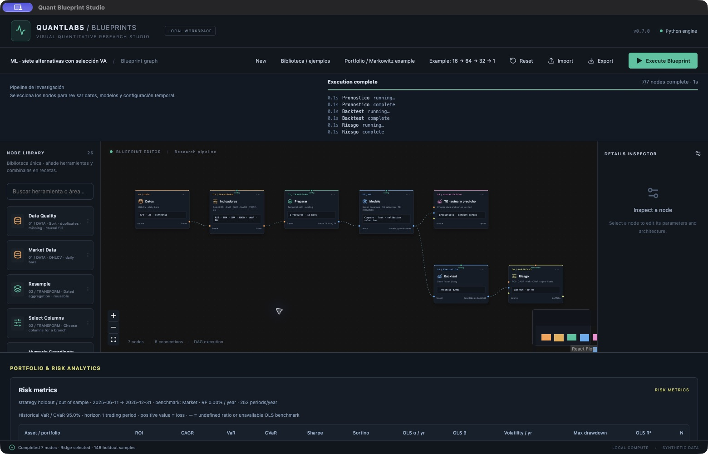

# Reingeniería de la biblioteca · v0.7.0

La biblioteca se evalúa por cobertura de tareas, composición, coste CPU, validación temporal y claridad del resultado. No existe un algoritmo ganador universal: se incorporan alternativas comparables y se separa selección VA de evaluación TE. QL se usa aquí como análisis cuantitativo; Q-learning pertenece a RL.

## Herramientas disponibles y elección

| Área | Herramientas disponibles | Cuándo empezar por ellas | Límites |
| --- | --- | --- | --- |
| Data | Market/Portfolio Data, Data Quality, selección, remuestreo, merge | Calidad/fechas antes de indicadores o modelos | yfinance o sintético; no CSV/Parquet como fuentes todavía |
| Features | Indicadores seleccionables, lags, coordenada, centrado, Standard/MinMax | Variables con significado y baseline pequeño | Coordenada artificial no es predictor económico; VWAP exige volumen |
| Visualización | Línea, área, barras, Scatter, puntos+curva, histograma, paneles de métricas | Series para tiempo, Scatter para relación, histograma para distribución | No heatmap, velas ni bandas de incertidumbre calibradas |
| ML lineal | Baseline de media, Ridge, ElasticNet | Referencia simple, regularización y diagnóstico | En esta versión son regresores; no clasificadores genéricos |
| ML no lineal | Random Forest, Histogram Boosting, SVR, KNN | Contrastar interacciones, kernels o vecinos frente a lineales | Parámetros explícitos; no búsqueda exhaustiva ni refit sobre VA |
| DL | Dense, CNN, LSTM/GRU, bidireccionales, CNN-LSTM, Transformer, AE/DAE | Ventanas temporales y arquitecturas comparadas con ML | CPU; no superioridad automática de una red más grande |
| DL generativo | CVAE, cGAN y cDCGAN dentro de Learning Experiment | Distribuciones y escenarios condicionales | Escenarios didácticos; no intervalos de cobertura calibrada |
| QL | Quant Features, Risk Metrics, portfolio, Markowitz y backtest | Retornos, drawdown y riesgo; comparar carteras en holdout | Long-only en Markowitz; costes/moneda/frecuencia deben configurarse |
| RL | RL Trading Agent: Double DQN, Q-learning, largo y efectivo; DQN anterior conservado | Comparar una política discreta Short/Cash/Long | No PPO/SAC ni entorno Gymnasium; estado actual usa última observación |

## Cambios de arquitectura aplicados

`src/renderer/data/node-contracts.json` es el registro compartido de entrada/salida, pines auxiliares y compatibilidad del contenido tensorial. El motor Python y las recomendaciones React lo leen. Las pruebas verifican que los 26 nodos, sus pines y sus contratos coincidan con el catálogo. Se mantiene el JSON de proyectos anteriores; ML añade el mismo ModelResult que ya consumen backtest y riesgo.

Los entrenadores no se duplican por receta. RL Trading Agent llama al mismo protocolo de Unidad 10; el Transformer entra en el entrenador DL existente; los modelos clásicos consumen Series Preparation. Los informes de RL/experimentos se conectan a Plot y no se tratan como rendimientos financieros.

## ML: protocolo verificable

Classical ML acepta los datos de Series Preparation. `last` usa la última observación de cada ventana; `flatten` concatena toda la ventana. X llega escalada con TR. Cada algoritmo ajusta el objetivo con media/desviación TR y devuelve predicciones en unidades originales.

Compare ajusta siete candidatos **sólo TR**, selecciona por MSE en VA y predice TE únicamente con el ganador. No reajusta con VA ni usa TE para ordenar alternativas. El informe muestra RMSE/MSE de validación y errores TE del ganador. El número de ventanas no supera 20 000 por split; SVR/Compare limita TR a 5 000 y flatten a 4 096 características para controlar coste. No se han medido tiempos garantizados para todos los equipos.

Los controles `alpha` y `C` comparten un campo por familia: en Ridge/ElasticNet es penalización, en SVR es C. El modelo usa semillas fijas y paralelismo de bosque limitado a un proceso. Histogram Boosting desactiva su división interna aleatoria para que VA siga siendo la partición externa explícita. El baseline de media ayuda a detectar modelos que no mejoran una referencia trivial.

Estas decisiones siguen el principio de ajustar transformaciones con entrenamiento y aplicar la misma transformación a los demás conjuntos, descrito por [scikit-learn](https://scikit-learn.org/stable/common_pitfalls.html). Las alternativas de validación expansiva y `gap` están documentadas en [TimeSeriesSplit](https://scikit-learn.org/stable/modules/generated/sklearn.model_selection.TimeSeriesSplit.html); el nuevo comparador usa un único TR/VA/TE, no se anuncia como walk-forward.

## DL y RL

Transformer proyecta features al tamaño hidden, añade posiciones sinusoidales y usa atención sobre la ventana histórica completa. El último token representa la ventana y la cabeza produce un escalar. Hidden debe ser divisible por 1/2/4/8 heads. Se inicializan de forma independiente las matrices de cada bloque. Toda la ventana antecede al objetivo; no se consulta un token de futuro. Se conserva el checkpoint VA del entrenador existente. Arquitecturas y módulos se basan en [torch.nn](https://docs.pytorch.org/docs/stable/nn.html).

El agente RL conserva replay TR, separación terminal, selección VA y evaluación greedy TE sin aprendizaje. Incluye Q-learning como referencia. PPO y SAC requieren entornos y algoritmos adicionales; no se añade un selector que invoque el algoritmo equivocado. Para un futuro adaptador Gymnasium deben distinguirse `terminated` y `truncated`, como explica [Farama](https://farama.org/Gymnasium-Terminated-Truncated-Step-API).

## Datos, QL y visualización

Data Quality ordena fechas, rechaza duplicados por defecto y permite resolverlos explícitamente con la última fila. Puede rechazar, eliminar o rellenar valores ausentes hacia delante con límite 1–30; no usa backfill. Los huecos iniciales o superiores al límite restante se eliminan. No inventa días no observados.

Quant Features exige precios positivos y fechas únicas ordenadas. Añade SimpleReturn, LogReturn, CumulativeLogReturn desde el primer precio, RollingVolatility, Drawdown y RollingSharpe. Ventanas causales, desviación muestral ddof=1, tasa libre de riesgo anual convertida al período y anualización configurable (252 diario, 12 mensual). Sharpe indefinido queda NaN. Las columnas calculadas con estos nombres se recalculan de forma explícita. Selecciona las necesarias y aplica Data Quality para retirar calentamiento antes de entrenar o graficar.

El histograma recibe una sola serie finita y 5–100 bins. Puede mostrar conteos o densidad; no presupone normalidad. La suma de los conteos coincide con las observaciones. El eje X representa centros de intervalos y el eje Y conteo/densidad, no fechas ni rentabilidad.

## Alternativas evaluadas y siguientes extensiones (no implementadas)

| Prioridad | Alternativas | Requisito previo |
| --- | --- | --- |
| Alta · datos | CSV/Parquet/Arrow, caché, calendarios, zona horaria, corporate actions y FX | Procedencia, esquema, permisos y alineación temporal verificables |
| Alta · evaluación | Walk-forward general con gap/embargo, intervalos conformales, calibración de clasificación | Transformadores nuevos por fold, aislamiento del tramo de selección y objetivo explícito |
| Alta · visual | Heatmap de correlación, velas OHLCV, residuos/Q-Q/ACF, bandas y selección de puntos | Metadatos de unidades, ejes y resultados estadísticos propios |
| Media · ML | Logistic regression, clasificadores, ExtraTrees, CatBoost/XGBoost/LightGBM, Gaussian Processes | Métricas por tarea, dependencias opcionales y benchmark con mismo presupuesto |
| Media · no supervisado | PCA independiente, clustering, IsolationForest y selección de variables | Ajustar TR, transformar VA/TE; no seleccionar con test |
| Media · DL | TCN, atención configurable por capas, exportación de pesos, GPU/AMP | Contratos de formas, serialización segura y pruebas de inferencia |
| Media · QL | Ledoit-Wolf, risk parity, CVaR optimization, factores, cointegración, GARCH | Estimación TR y backtest causal con costes, restricciones y frecuencia correctas |
| Media · RL | Gymnasium, PPO/A2C/SAC, acciones continuas, múltiples semillas | Environments versionados, semántica terminal/truncación y presupuesto comparable |
| Transversal | Registro de experimentos, caché por nodo, versiones de datasets, cancelación y límites de memoria | Estado de ejecución y resultados persistentes distintos del grafo guardado |

La lista es un mapa de alternativas, no una declaración de cobertura de todo ML/RL. La prioridad busca completar tareas reproducibles sin añadir dependencias o menús que no ejecutan su función.

## Cómo probarlo

En Biblioteca aparecen seis recetas nuevas: **Data · calidad y relleno causal**, **Visualización · distribución de retornos**, **ML · siete alternativas con selección VA**, **DL · Transformer de ventana histórica**, **QL · retornos y riesgo móvil** y **RL · Double DQN y Q-learning**. Todas usan datos sintéticos por defecto y permiten editar parámetros, importar/exportar y ejecutar. Los 21 diseños anteriores se conservan.

