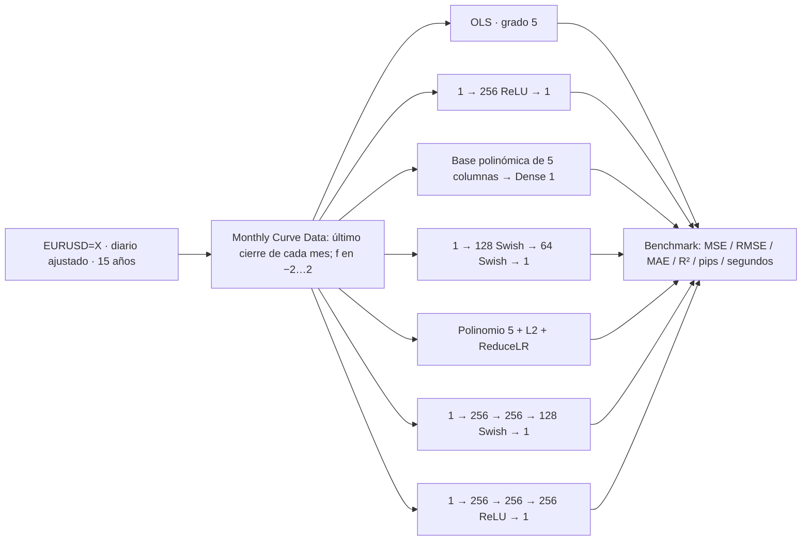
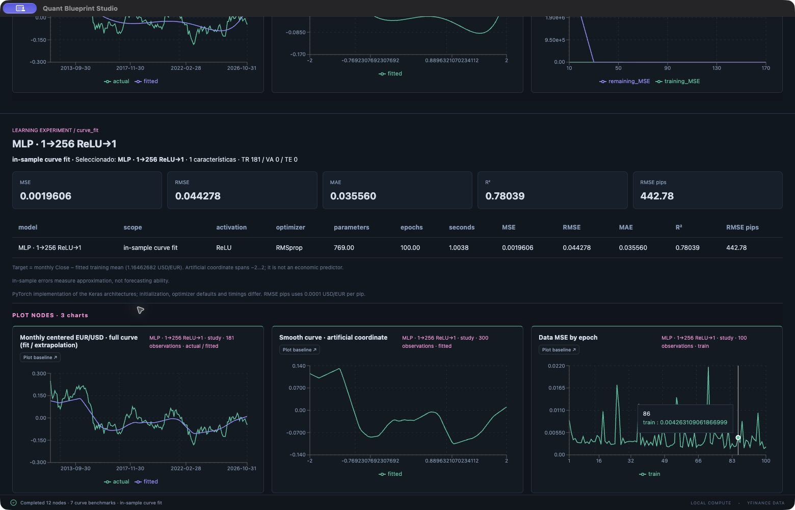
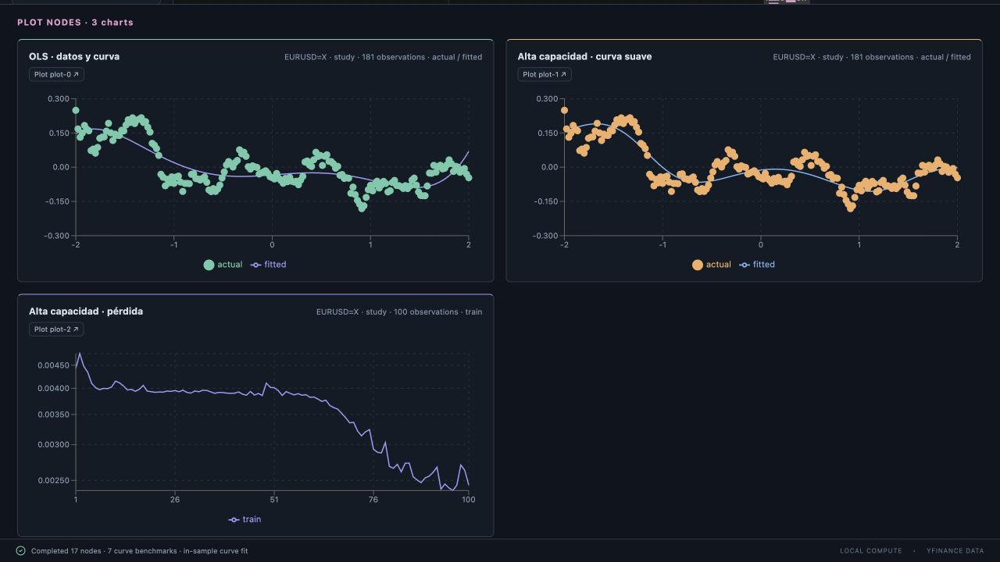

# Blueprint del notebook EUR/USD

Fuente: `B_13Oct26_Ibero_de_05_IA_01_documentado.ipynb` (82 celdas). Se analizó el código y las notas; no se ejecutó el archivo ni se alteraron sus contenidos. El hash del original y el mapa de celdas están en [NOTEBOOK_CURVE_SOURCE.json](NOTEBOOK_CURVE_SOURCE.json).

## Cómo abrirlo

En **Biblioteca / ejemplos**, selecciona el área **Notebook · aproximación EUR/USD**:

- **Inicio rápido**: siete modelos, 100 épocas por red; recomendado para comprobar el flujo.
- **Arquitectura y épocas originales**: 1500 épocas, 2000 en alta capacidad y 2500 en DNN.
- **Evaluación temporal**: 65% TR, 15% VA y 20% TE; media y escalas sólo TR, checkpoint neuronal por VA y errores TE de extrapolación.

Pulsa **Cargar y ejecutar**. El benchmark conjunto aparece debajo del lienzo, seguido por los informes de cada rama. Para guardar cambios, usa **Guardar copia** o **Exportar**. También puedes importar directamente los archivos `notebook-curve-*.json` incluidos en `quant-blueprint-studio/public/blueprints/`.

La fuente de las tres fichas es **yfinance / EURUSD=X / 15 años**, como en el notebook. Requiere internet. Para una demostración sin red, cambia Market Data a `synthetic`: genera datos ilustrativos que no son cotizaciones EUR/USD.

## Flujo y correspondencia

| Celdas del archivo documentado (índice desde 0) | Nodo / configuración |
| --- | --- |
| 7 | Market Data: cierre ajustado diario EURUSD=X, 15 años |
| 9 | Monthly Curve Data: último cierre disponible por mes |
| 13, 15 | Target Close menos media; Coordinate uniforme entre −2 y 2 |
| 21 | Vectores alineados: una predicción por observación, sin broadcasting |
| 23–25 | OLS grado 5 |
| 30 | Gráfico adicional OLS: ajuste cúbico a prefijos 10,30,… y error de extrapolación restante |
| 37–42 | MLP 1→256 ReLU→1, RMSprop, 1500 épocas, 769 parámetros |
| 46–52 | PolynomialFeatures de grado 5 sin bias, StandardScaler, Dense 1 con Adam .01, 1500 épocas |
| 53–59 | Normalización, 128/64 Swish, Adam .001, 1500 épocas |
| 60–66 | Polinomio normalizado, L2 .01, Adam .05, ReduceLR factor .5 / paciencia 30 / mínimo 1e−5 |
| 68–72 | Normalización, 256/256/128 Swish, Adam .001, 2000 épocas |
| 74–79 | Tres capas de 256 ReLU, RMSprop, 2500 épocas |
| 81 | Benchmark conjunto de errores, tiempos, activadores y optimizadores; cada rama permite cambiarlos |

**Monthly Curve Data** no agrega RSI, VWAP ni retornos. Este notebook emplea precios mensuales y una única coordenada artificial. En cada **Curve Fitting / Benchmark**, el objetivo se centra con la media del conjunto que se ajuste. La expansión polinómica genera cinco entradas a partir de esa coordenada; no son cinco indicadores financieros.

**Curve Fitting / Benchmark** permite modificar anchos ocultos, activación, optimizador, épocas, lote, LR, L2, normalización, scheduler y protocolo de evaluación. La salida es lineal. Se pueden duplicar ramas para comparar otras configuraciones y conectarlas a Plot. Los índices del gráfico son: 0 = datos mensuales y curva; 1 = curva suave en 300 coordenadas; 2 = pérdidas por época en modelos neuronales, o extrapolación por prefijos en OLS.

## StandardScaler

Desde v0.5.2, la ficha temporal activa StandardScaler en todas las ramas neuronales. Las fichas rápida y original mantienen las decisiones del notebook. El checkbox de normalización se respeta también en los polinomios neuronales. Después de ejecutar, **Normalización · auditoría** muestra el método, filas, centro y divisor de cada rama. [Detalle y pruebas](SCALING.md).

## Interpretación y diferencias controladas

- **in_sample** ajusta y evalúa las mismas observaciones, igual que el ejercicio. No mide éxito de pronóstico. El benchmark lo identifica explícitamente.
- **temporal** es una extensión de evaluación: los puntos finales son extrapolación de una coordenada artificial. Una menor MSE no acredita una estrategia financiera.
- El modo original conserva el último mes aunque esté incompleto; el temporal lo excluye si es el mes actual. El parámetro está en Monthly Curve Data. Las fechas exactas y número de meses dependen de cuándo se descarguen los datos.
- Las métricas aplanan ambos vectores y exigen igual longitud y valores finitos. RMSE en pips divide por 0.0001 USD/EUR. No se toma una MSE corrupta de las salidas guardadas ni se garantiza superar 0.000616.
- El motor usa **PyTorch**, no TensorFlow/Keras. Se reproducen las arquitecturas y operaciones principales, con diferencias de inicialización, detalles de optimizadores y hardware. No se prometen pesos ni resultados numéricos idénticos. L2 penaliza pesos y excluye sesgos. Los tiempos son locales.
- Los informes incluyen pérdida **de datos**, separada de la penalización L2. No incluyen el tamaño de una GPU detectada por el notebook original como propiedad del equipo actual.

Para abrir el notebook acompañante, instala el kernel opcional con `.venv/bin/python -m pip install -r requirements-notebook.txt` dentro de `quant-blueprint-studio`, y selecciona esa `.venv` en tu editor compatible con Jupyter. Esta dependencia no es necesaria para ejecutar los blueprints desde Electron.

El [notebook acompañante](../quant-blueprint-studio/examples/notebook_eurusd_blueprint.ipynb) carga el mismo grafo y ejecuta el motor local. Es una reproducción del blueprint que depende del proyecto instalado; no reemplaza ni modifica el notebook original.

## Herramientas añadidas para completar el notebook (v0.5.3)

Se reutilizan los nodos y cálculos existentes. Se añadieron las capacidades que faltaban para construir las capas y representar las figuras:

| Herramienta existente | Capacidad añadida | Uso |
| --- | --- | --- |
| Network Layer | Swish como activación Dense o como capa individual | Elegir `Swish`; implementada mediante [SiLU de PyTorch](https://docs.pytorch.org/docs/2.15/generated/torch.nn.SiLU.html) |
| Curve Fitting / Benchmark | Pin morado de arquitectura | Conectar Network Input → capas → Network Output → pin network del entrenador |
| Informe de curva | Resumen real de capas, formas y parámetros | Abrir **Arquitectura · … parámetros** después de ejecutar; corresponde al `model.summary()` del ejercicio |
| Plot | `scatter` y `scatter_line`, X numérica seleccionable | Para puntos observados + curva: índice 0, X=`coordinate`, tipo=`scatter_line`, serie de puntos=`actual` |
| Plot | Escala Y logarítmica y descarte inicial de filas | Para pérdidas: índice 2, X=`epoch`, Y=`log`; `skip_rows=100` reproduce el corte inicial del historial |

Para una red densa, Network Input declara **1** característica. Para la rama `polynomial_net` de grado 5 declara **5**; esta expansión y StandardScaler permanecen en el entrenador existente. Con **Match selected features automatically**, la dimensión se sincroniza al conectar la arquitectura. Network Output mantiene una salida lineal. Cuando hay red conectada, sus capas controlan los anchos y activaciones y esos campos del entrenador se desactivan.

Las tres fichas del notebook muestran ahora la rama **1→256 Swish→256 Swish→128 Swish→1** con capas conectables y **99,329 parámetros**. La biblioteca sigue teniendo 18 fichas. Las demás ramas conservan sus configuraciones; también admiten un pin de red si deseas construirlas manualmente. Una red de entrada 5 conectada directamente a Network Output implementa el polinomio neuronal lineal 5→1 (6 parámetros).

En `scatter_line`, para la salida de curva índice 0 con X=`coordinate`, los puntos usan los meses observados y la línea ajustada usa la malla de 300 coordenadas del notebook. Los colores y leyendas siguen configurándose en Plot. Los puntos y las líneas combinadas están soportados por [Recharts Scatter en ComposedChart](https://recharts.github.io/en-US/api/Scatter/).

Y=`log` exige valores finitos estrictamente positivos; para datos centrados que incluyen negativos usa `linear`. El descarte debe dejar al menos una observación. La ficha de épocas originales configura 100 filas de descarte para las pérdidas; inicio rápido y temporal no descartan filas porque usan sólo 100 épocas de demostración.

