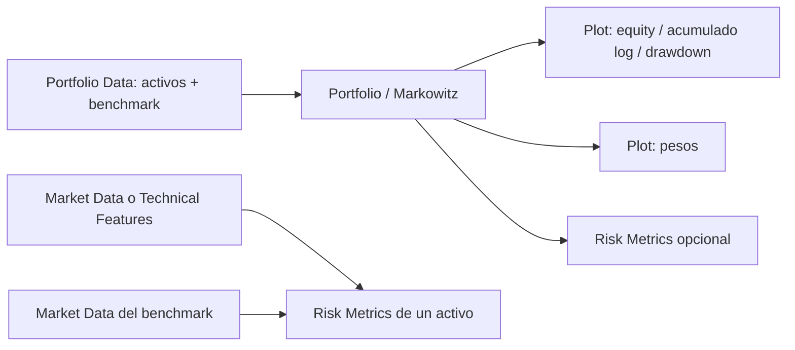

# Portafolios y métricas de riesgo

## Diseño de nodos

`Portfolio Data` entrega cierres diarios ajustados, no indicadores ni volumen. Así se puede analizar EURUSD sin activar un VWAP imposible por volumen cero. Fechas: intersección de activos y benchmark, sin forward-fill; al menos 100 precios comunes. Símbolos inexistentes, precios no positivos, duplicados o insuficiencia de fechas producen un error. No hay conversión de moneda: el usuario debe aportar activos en una moneda común o precios convertidos externamente.

`Portfolio / Markowitz` estima con un tramo inicial y evalúa en el posterior. Por defecto 70/30; mínimo 60 retornos de estimación y 20 de prueba. Las métricas de los activos y de todas las asignaciones usan las mismas fechas del holdout. Pesos personalizados y pesos iguales no usan los datos del holdout para elegir asignación. El benchmark solo entra en la optimización si también se seleccionó como activo.

`Risk Metrics` conectado directamente a Portfolio Data muestra métricas históricas de los activos sobre todo el historial común. Conectado a un portafolio o backtest conserva el periodo de evaluación. La etiqueta de alcance aparece en el informe. Un DataFrame usa por defecto `LogReturn` (logarítmico); si solo contiene `Close`, se calculan retornos simples. Para otra columna de precios, seleccionar `return_type=price`. No pasar acumulados como retornos diarios.

## Retornos y convenciones

Los cálculos usan retornos simples por periodo, en decimales (`0.01 = 1%`). Si la entrada es logarítmica, `r = exp(LogReturn) − 1`. Sea `n` el número de retornos, `A` los periodos anuales (252 por defecto), `Rf` la tasa libre de riesgo anual efectiva y `rf = (1 + Rf)^(1/A) − 1` su equivalente por periodo. La frecuencia de todos los datos debe ser la misma.

| Métrica | Definición y unidades |
| --- | --- |
| ROI | `prod(1+r) − 1`, porcentaje total del tramo evaluado |
| CAGR | `prod(1+r)^(A/n) − 1`, anualización geométrica según periodos de negociación |
| Volatilidad | `std(r, ddof=1) * sqrt(A)`, anual |
| Sharpe | `mean(r−rf) / std(r, ddof=1) * sqrt(A)` |
| Sortino | `mean(r−rf) / sqrt(mean(min(r−rf, 0)^2)) * sqrt(A)`; objetivo mínimo = tasa libre de riesgo |
| VaR | Cuantil histórico de pérdidas `−r`, a la confianza elegida; interpolación lineal |
| CVaR | Media de pérdidas históricas mayores o iguales al umbral VaR |
| OLS alpha/beta | Regresión `r−rf = alpha_diaria + beta*(benchmark−rf) + error`; alpha mostrada = `alpha_diaria*A`, anualización aritmética |
| OLS R² | Coeficiente de determinación de la regresión, no métrica de la red neuronal |
| Drawdown máximo | Mínimo de `equity / máximo_hasta_fecha − 1`, incluyendo capital inicial 1 |

VaR/CVaR tienen **horizonte de un periodo** (un día con los datos por defecto); no se anualizan. Un valor positivo representa pérdida, uno negativo puede indicar ganancias incluso en la cola observada. Ratios con denominador cero y OLS sin benchmark válido/variable se muestran como `—`. Alpha anual aritmética y CAGR geométrico son magnitudes distintas. No se hacen estimaciones gaussianas ni escalado por raíz del tiempo para VaR.

## Optimización

La media y covarianza se estiman exclusivamente en entrenamiento. El estimador predeterminado es Ledoit–Wolf (shrinkage); opcionalmente covarianza muestral. Se anualizan multiplicando por `A`; se añade una cresta numérica de `1e-10` a la covarianza anual para estabilizar espacios nulos.

- **Mínima varianza:** minimiza `wᵀΣw`.
- **Máximo Sharpe:** maximiza el exceso esperado sobre su volatilidad; SLSQP con varios puntos iniciales factibles. Es una solución numérica: se comprueban convergencia y restricciones.
- Restricciones: `sum(w)=1`, `0 ≤ w_i ≤ max_weight`. El límite debe permitir una asignación factible: `N*max_weight ≥ 1`. El límite es para Markowitz; los pesos personalizados se validan como no negativos y suma uno.
- Rendimientos sin varianza no producen un Sharpe artificial. Si no converge una solución válida se muestra un error, sin devolver pesos inventados.
- Las soluciones de Markowitz son estimadas con retornos brutos; los costes se aplican en la evaluación posterior, no se optimizan dentro de la función objetivo.

## Rebalanceo y costes

`daily` mantiene los pesos objetivo diariamente. Calcula la deriva de pesos tras el retorno de cada día y el turnover necesario para regresar al objetivo. `buy_hold` invierte inicialmente y deja derivar los pesos: el resultado es la suma ponderada de los patrimonios individuales, no la suma diaria de retornos con pesos constantes.

El coste es `(fee_bps + slippage_bps)/10000` por notional comprado o vendido; se aplica a entrada, turnover y liquidación final. No se divide entre dos el notional de compras más ventas. Las métricas de los activos y el benchmark son referencias brutas; las de las asignaciones incorporan los costes configurados. No se simulan impuestos, financiación, liquidez o un mecanismo de cambio de moneda.

## Gráficos

Los pines amarillos de Portfolio Data, Portfolio / Markowitz y Risk Metrics conectan con Plot. Modos:

- `asset_prices`: precios ajustados de los activos (escala original).
- `equity`: retorno simple acumulado de cada asignación, desde capital inicial 1.
- `cumulative_log`: suma acumulada de `log(1+r)` de cada asignación o serie analizada.
- `drawdown`: caída desde el máximo alcanzado.
- `weights`: pesos por activo y asignación; suele resultar más claro con barras.

Series de portafolio: `equal_weight,max_sharpe,min_variance,custom` (la última solo existe si se configuraron pesos). Los nombres de series se conservan en el JSON; las leyendas pueden renombrarse. La paleta y los nombres se guardan con Export. Cambiar presentación no repite entrenamiento ni optimización.

## Referencias de implementación

- [SciPy: SLSQP y sus restricciones](https://docs.scipy.org/doc/scipy/reference/optimize.minimize-slsqp.html).
- [statsmodels: OLS y término constante explícito](https://www.statsmodels.org/stable/generated/statsmodels.regression.linear_model.OLS.html).
- [NumPy: cuantiles e interpolación lineal](https://numpy.org/doc/stable/reference/generated/numpy.quantile.html).
