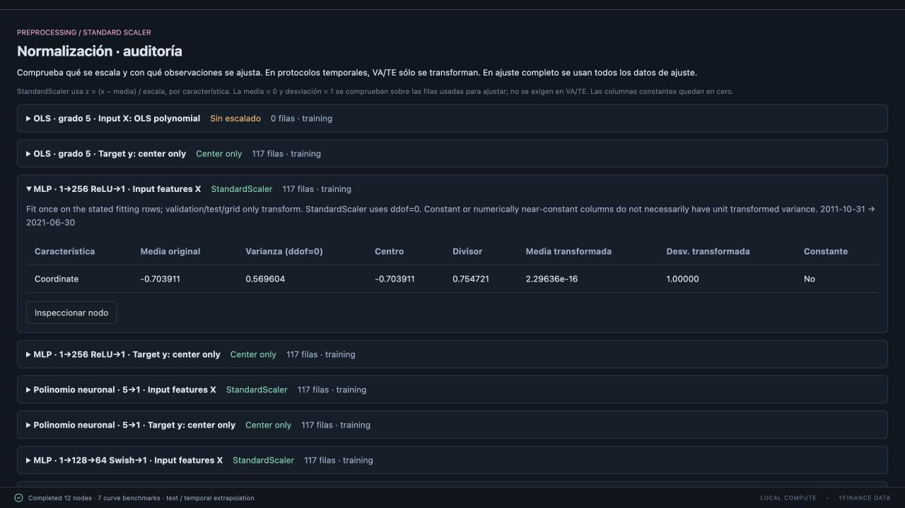

# Auditoría de StandardScaler — v0.5.2

Se revisaron preparación general, experimentos supervisados, HPO, PCA/AE/DAE, condiciones generativas, Double DQN y curvas del notebook. El criterio temporal es: dividir primero; ajustar parámetros con TR; reutilizar el mismo transformador en VA/TE y en la malla de gráficos. Se sigue la [guía oficial para evitar fuga de datos](https://scikit-learn.org/stable/common_pitfalls.html#data-leakage).

## Hallazgos y correcciones

- No se encontró ajuste de StandardScaler con VA/TE en los flujos temporales revisados. Se añadieron pruebas que alteran sólo observaciones posteriores al corte y exigen que no cambien sus estadísticas de ajuste.
- Se corrigió un fallo del checkbox del nodo polinómico: `normalize=False` era ignorado y StandardScaler seguía activo. Ahora el checkbox controla realmente el escalado de sus columnas polinómicas.
- PolynomialFeatures se ajusta explícitamente con TR y después transforma el resto. Esta expansión no aprende medias ni varianzas, pero se hace explícita su separación para evitar ambigüedad.
- La preparación rechaza nombres de escalador desconocidos, en lugar de sustituirlos silenciosamente por StandardScaler. Se comprueban matrices de entrada finitas y nombres/dimensiones consistentes.
- La ficha temporal del notebook activa StandardScaler en las seis ramas neuronales. Las fichas de inicio rápido y referencia conservan las opciones originales: MLP 256 ReLU y DNN 3×256 sin normalización; polinomios neuronales, Swish y alta capacidad con normalización. OLS usa la coordenada original.
- Las métricas del notebook restauran explícitamente la media del precio antes de compararlo con Close original; las curvas se muestran centradas. Antes se comparaban predicciones y objetivos igualmente centrados: MSE/RMSE/MAE/R² son invariantes a ese desplazamiento común, pero ahora la inversión se expresa también en código y en la auditoría.

No se modifica automáticamente el parámetro `normalize` en los diseños personales ya guardados. Para usar la configuración nueva, carga de nuevo **Notebook EUR/USD · evaluación temporal**, o activa la opción en la rama deseada. Esto conserva las decisiones del usuario y la reproducción de las fichas originales.

## Dónde se ajusta cada escala

| Flujo | Filas de ajuste | Aplicación posterior |
| --- | --- | --- |
| Series Preparation | Unión de barras de entrada usadas por ventanas TR, cada barra una vez | Mismo scaler por característica en ventanas TR/VA/TE |
| Experimentos supervisados | Misma unión de barras TR, antes de repetir ventanas | Mismas medias/desviaciones para todos los pasos de cada ventana |
| Búsqueda temporal de hiperparámetros | Un scaler nuevo por fold expansivo, usando sólo su entrenamiento interno | Validación interna transformada sin reajuste; scaler TR nuevo para el modelo final |
| PCA / AE / DAE | Última barra de cada muestra TR, que es la entrada de esos experimentos | Reconstrucción/latentes sobre entradas escaladas; Ridge usa objetivo original |
| Double DQN | Indicadores TR de las observaciones de estado | Posición categórica −1/0/+1 se añade después; no se incluye en StandardScaler |
| Generativos | Condiciones causales de ventanas íntegramente TR | Log-volatilidad, momentum y log-volumen se escalan; los IDs de activo y embeddings no |
| Curvas temporales | Coordenada TR, o sus columnas polinómicas 1…grado | Mismo scaler en VA/TE y malla suave; sin clipping |
| Curvas de ajuste completo | Todas las observaciones declaradas como ajuste in-sample | Se identifica explícitamente: no existe un holdout en ese protocolo |

En ventanas de longitud L y N muestras TR, hay L+N−1 barras de entrada únicas para ajustar X. La barra que se utiliza únicamente como objetivo de la última muestra TR no entra en el ajuste de X. Aplanar todas las ventanas para **ajustar** repetiría las barras centrales y cambiaría sus pesos; aquí se ajusta sobre la unión de barras. Para **transformar**, sí se reorganiza el tensor a filas×características y se restituye su forma original.

## Objetivo y unidades

StandardScaler de X y la transformación de y son operaciones diferentes:

- Regresión general y experimentos supervisados: y se centra y divide por la desviación calculada con etiquetas TR (ddof=0, divisor mínimo 1e−8). Es una transformación media/desviación explícita; no se presenta como una instancia de StandardScaler. Las predicciones se invierten antes de calcular los errores.
- Clasificación: etiquetas 0/1 y probabilidades sigmoid sin StandardScaler.
- Notebook de curvas: sólo se resta la media de Close de ajuste; no se divide por su desviación. Las métricas se calculan tras sumar esa media a la predicción.
- Generativos: retornos de ventanas TR con una escala global media/desviación; un retorno que aparece en ventanas solapadas cuenta en cada aparición. Las condiciones tienen un StandardScaler aparte. Se conserva este protocolo del experimento; no se mezcla con el criterio de barras únicas de los predictores.

## Cómo comprobarlo en pantalla

Tras ejecutar, abre **Normalización · auditoría**, debajo de los gráficos de Plot y antes de los informes de experimentos. Aparecen método, rama, ámbito y número de filas usadas para ajustar. Expande una fila para ver, por característica:

- Media y varianza originales (ddof=0).
- Centro y divisor efectivos.
- Media y desviación de las filas de ajuste transformadas.
- Columnas constantes y si se invierte la transformación de y antes de las métricas.

`StandardScaler`: media TR próxima a 0 y desviación próxima a 1 en columnas no constantes, salvo protección numérica de columnas casi constantes. Las constantes exactas quedan en 0 y el divisor es 1. `MinMaxScaler` no busca media 0/desviación 1; su centro es el mínimo y su divisor el rango efectivo. `Center only` no impone desviación 1. `Sin escalado` significa que está desactivado o no corresponde al método OLS.

VA/TE no tienen por qué quedar con media 0 o desviación 1: imponerlo ajustando otro scaler filtraría estadísticas del periodo evaluado. StandardScaler tampoco limita valores a −1…1 ni −2…2. Documentación de la [transformación y casos constantes](https://scikit-learn.org/stable/modules/generated/sklearn.preprocessing.StandardScaler.html).

## Evidencia automática

`backend/tests/test_scaling.py` comprueba fórmula por columna, ddof, columnas constantes, inversión, reutilización del mismo scaler fuera de muestra, corte exacto de barras, ventanas sin duplicación, checkbox polinómico, ajuste con TR, folds HPO, etiquetas binarias, IDs de activo sin escalar, unidades de errores y serialización de auditorías.

La prueba de coordenadas multiplica −2…2 por ½ (−1…1) y compara predicciones y MSE de una red densa y un polinomio neuronal con StandardScaler y semilla fija. Los resultados son iguales dentro de la tolerancia numérica. No exige un R² más alto como condición: verifica que el escalado se aplica correctamente.
