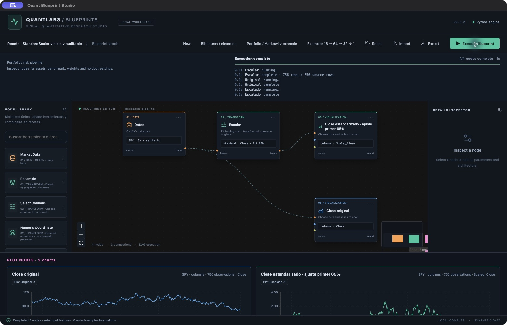

# Biblioteca única · v0.7.0

La paleta del lienzo es el catálogo común de herramientas. Busca por nombre o área y añade nodos por clic, arrastre o mediante las alternativas de un conector. Biblioteca / ejemplos contiene recetas del mismo catálogo, con JSON editable y un apartado «Herramientas de esta receta». No hay que instalar un motor distinto por ejemplo.

## Operaciones reutilizables

| Herramienta | Entrada → salida | Configuración |
| --- | --- | --- |
| Select Columns | DataFrame → DataFrame | columnas CSV; conserva fechas |
| Resample | DataFrame → DataFrame | columnas, W-FRI/ME/QE/YE, last/mean/sum, excluir período incompleto |
| Numeric Coordinate | DataFrame → DataFrame | rango y nombre; conserva originales; coordenada artificial |
| Center Columns | DataFrame → DataFrame | columnas, prefijo y fracción inicial de ajuste; resta media sin dividir |
| Scale Columns | DataFrame → DataFrame | Standard/MinMax, columnas, prefijo y fracción inicial de ajuste |

Las columnas derivadas se añaden con prefijo: `Centered_Close` y `Scaled_Close`; no sustituyen Close. Los valores ausentes o infinitos se rechazan al centrar/escalar. La auditoría muestra las fechas y filas de ajuste. StandardScaler ajusta una vez y transforma las filas restantes; MinMax puede producir valores fuera de 0…1 fuera de la muestra de ajuste.

`fit_fraction=1` es ajuste descriptivo de toda la muestra. En uso temporal, Preparation, Curve Fitting y Learning Experiment comprueban la fecha máxima de ajuste de columnas derivadas seleccionadas. El 65% de filas no equivale necesariamente al corte TR de ventanas: reduce la fracción o utiliza preferentemente el escalador integrado en Series Preparation, que conoce exactamente ese corte. Su escalado posterior permanece activo; evita una segunda normalización innecesaria.

Resample aplica la agregación elegida a cada columna: `last` no construye automáticamente una vela OHLCV. Para cierres mensuales selecciona Close y last. Excluir período incompleto omite el período cuyo cierre aún no ha terminado según la fecha local del motor.

## Recetas modulares

**Receta · mensual → coordenada → centrado → Scatter** reproduce el código de la muestra sin entrenador: Datos → Select Columns → Resample → Numeric Coordinate → Center Columns → Plot. Usa synthetic por defecto; cambia a yfinance para datos reales. El centrado usa toda la muestra y el gráfico se identifica como descriptivo.

**Receta · StandardScaler visible y auditable** muestra original y columna transformada en gráficos separados y registra el ajuste sobre las primeras filas.

## Compatibilidad y alcance

Los diseños anteriores se conservan. Monthly Curve Data reutiliza las mismas funciones de Resample y Numeric Coordinate. Preparación temporal sigue encapsulando ventanas, particiones y su escalado seguro. Curve Fitting conserva el centrado de su objetivo y su protocolo; Learning Experiment conserva algoritmos específicos de selección, generativos y RL. No se presentan esos entrenadores compuestos como operaciones atómicas ni como réplicas numéricas de Keras.

Los pines azules muestran su contenido: particiones TR/VA/TE, modelo/predicciones, backtest o informe de experimento. Las recomendaciones y validación distinguen estos contenidos aunque compartan color. Los informes se conectan a Plot; no se convierten en retornos financieros por conectar Risk Metrics. Las capas moradas ya existentes siguen siendo reutilizables y editables.

## Mapa de todas las recetas

Los nombres de tipo siguientes corresponden a herramientas del catálogo, en orden de aparición dentro de la receta (no necesariamente orden de ejecución).

| Receta | Área | Herramientas |
| --- | --- | --- |
| [Unidad 2 · Feedforward 11 → 64 → 32 → 1](../quant-blueprint-studio/public/blueprints/unit-2.json) | Redes feedforward | source → features → study → plot |
| [Unidad 3 · SGD / RMSprop / AdamW](../quant-blueprint-studio/public/blueprints/unit-3.json) | Entrenamiento | source → features → study → plot |
| [Unidad 4 · Regularización y dirección](../quant-blueprint-studio/public/blueprints/unit-4.json) | Regularización | source → features → study → plot |
| [Unidad 5 · Búsqueda temporal](../quant-blueprint-studio/public/blueprints/unit-5.json) | Hiperparámetros | source → features → study → plot |
| [Unidad 6 · CNN 1D](../quant-blueprint-studio/public/blueprints/unit-6.json) | Redes convolucionales | source → features → study → plot |
| [Unidad 7 · LSTM / GRU / bidireccional](../quant-blueprint-studio/public/blueprints/unit-7.json) | Redes recurrentes | source → features → study → plot |
| [Unidad 8 · PCA / AE / DAE](../quant-blueprint-studio/public/blueprints/unit-8.json) | Representaciones | source → features → study → plot |
| [Unidad 9 · CVAE / cGAN](../quant-blueprint-studio/public/blueprints/unit-9.json) | Modelos generativos | source → features → study → plot |
| [Unidad 9 ampliación · cDCGAN 1D](../quant-blueprint-studio/public/blueprints/unit-9-cdcgan.json) | Modelos generativos | source → features → study → plot |
| [Unidad 10 · Double DQN](../quant-blueprint-studio/public/blueprints/unit-10.json) | Aprendizaje por refuerzo | source → features → study → plot |
| [Retornos diarios y acumulados](../quant-blueprint-studio/public/blueprints/area-returns.json) | Datos e indicadores | source → features → plot |
| [VWAP / MACD / EMA / SMA / BB](../quant-blueprint-studio/public/blueprints/area-indicators.json) | Datos e indicadores | source → features → plot |
| [Descomposición y escalado](../quant-blueprint-studio/public/blueprints/area-stats.json) | Estadística | source → features → prepare → plot |
| [Red modular · 11 → 64 → 32 → 1](../quant-blueprint-studio/public/blueprints/area-network.json) | Arquitectura y backtest | source → features → prepare → model → backtest → network_input → layer → network_output |
| [Portafolio · Markowitz y riesgo completo](../quant-blueprint-studio/public/blueprints/area-portfolio.json) | Portafolios y riesgo | portfolio_data → portfolio → plot |
| [Notebook EUR/USD · inicio rápido](../quant-blueprint-studio/public/blueprints/notebook-curve-quick.json) | Notebook · aproximación EUR/USD | source → curve_data → curve_fit → plot → network_input → layer → network_output |
| [Notebook EUR/USD · arquitectura y épocas originales](../quant-blueprint-studio/public/blueprints/notebook-curve-reference.json) | Notebook · aproximación EUR/USD | source → curve_data → curve_fit → plot → network_input → layer → network_output |
| [Notebook EUR/USD · evaluación temporal](../quant-blueprint-studio/public/blueprints/notebook-curve-temporal.json) | Notebook · aproximación EUR/USD | source → curve_data → curve_fit → plot → network_input → layer → network_output |
| [Infografía Keras · 1 → 256 ReLU → 1](../quant-blueprint-studio/public/blueprints/notebook-keras-1-256-1.json) | Notebook · arquitectura neuronal | source → curve_data → network_input → layer → network_output → curve_fit → plot |
| [Receta · mensual → coordenada → centrado → Scatter](../quant-blueprint-studio/public/blueprints/recipe-monthly-sample.json) | Herramientas · recetas modulares | source → select_columns → resample → coordinate → center → plot |
| [Receta · StandardScaler visible y auditable](../quant-blueprint-studio/public/blueprints/recipe-column-scaling.json) | Herramientas · recetas modulares | source → scale_columns → plot |

La ampliación por Data, visualización, ML, DL, QL y RL se documenta en [auditoría de reingeniería](LIBRARY_REENGINEERING.md). Son 26 tipos de herramienta y 27 recetas.

## Nuevas recetas por área (v0.7.0)

| Receta | Herramientas |
| --- | --- |
| [ML · siete alternativas con selección VA](../quant-blueprint-studio/public/blueprints/research-ml-compare.json) | source → features → prepare → ml_model → plot → backtest → risk |
| [DL · Transformer de ventana histórica](../quant-blueprint-studio/public/blueprints/research-dl-transformer.json) | source → features → prepare → model → plot → backtest → risk |
| [RL · Double DQN y Q-learning](../quant-blueprint-studio/public/blueprints/research-rl-agent.json) | source → features → rl_agent → plot |
| [Data · calidad y relleno causal](../quant-blueprint-studio/public/blueprints/research-data-quality.json) | source → data_quality → plot |
| [QL · retornos y riesgo móvil](../quant-blueprint-studio/public/blueprints/research-quant-features.json) | source → quant_features → select_columns → data_quality → plot → risk |
| [Visualización · distribución de retornos](../quant-blueprint-studio/public/blueprints/research-visual-histogram.json) | source → features → plot |
